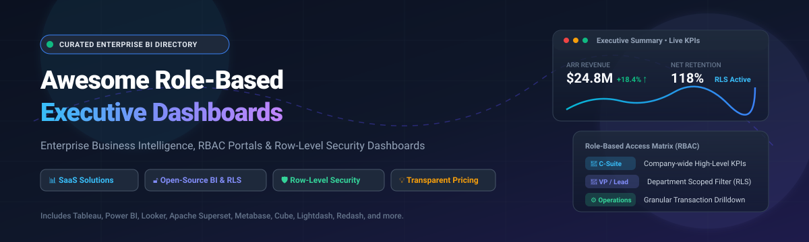

  

# 📊 Awesome Role-Based Executive Dashboards

  
  
  
  
  
  

> 🚀 **Awesome Role-Based Executive Dashboards** is a comprehensively curated catalog and market intelligence directory of leading Business Intelligence (BI), KPI reporting platforms, and modern analytics engines. Delivering role-tailored views with fine-grained access control (RBAC) and row-level security (RLS) across C-Suite leaders, operational managers, and cross-functional teams.
>
> 🌟 *Star this repository if you find it helpful for your enterprise architecture, data stack evaluation, or executive KPI design!* 🌟

---

## 🔍 SEO & Discovery Keywords
`executive dashboards` • `role-based access control` • `business intelligence` • `row-level security` • `kpi dashboard` • `enterprise reporting` • `open-source bi` • `self-hosted bi` • `data visualization` • `tableau alternatives` • `power bi alternatives` • `analytics portal` • `modern data stack`

---

## 📋 Table of Contents

- [🌐 Sector Overview & Market Dynamics](#-sector-overview--market-dynamics)
- [🟦 SaaS / Hosted Platforms](#-saas--hosted-platforms)
  - [SaaS Platforms Feature & Pricing Matrix](#-saas-platforms-feature--pricing-matrix)
  - [Platform Deep Dives](#-platform-deep-dives)
- [🟩 Open-Source Software](#-open-source-software)
  - [Open-Source Solutions by Stars_Count](#-open-source-solutions-by-star-count)
  - [Open-Source Deep Dives](#-open-source-deep-dives)
- [📊 Enterprise Architecture Comparison](#-enterprise-architecture-comparison)
- [📈 Star History](#-star-history)
- [☕ Support & Sponsorship](#-support--sponsorship)
- [🤝 Contributing](#-contributing)
- [📄 License](#-license)

---

## 🌐 Sector Overview & Market Dynamics

The global Business Intelligence (BI) and analytics software market is valued at approximately **$33.14 billion in 2025** and is projected to surpass **$41 billion by 2026** (scaling past $70B+ by the early 2030s at a CAGR of ~11–13%). 

Structurally, the industry displays a **moderately concentrated oligopolistic core** led by mega-cap hyperscalers (Microsoft Power BI, Salesforce Tableau, Google Cloud Looker) who leverage cloud suite bundling and distribution power, alongside a **vibrant, highly fragmented edge** of specialized dashboard platforms, headless semantic layer engines, and self-hosted open-source innovators catering to data privacy, customizable embedded analytics, and developer-centric workflows.

---

## 🟦 SaaS / Hosted Platforms

Commercial, cloud-hosted executive reporting and role-based business intelligence suites offering managed hosting, enterprise SLA guarantees, and out-of-the-box identity federation.

### 💳 SaaS Platforms Feature & Pricing Matrix

*The table below is sorted descending by Company Size (Revenue / Valuation).*

| 🏢 Platform | 💰 Company Size (Rev / Valuation) | 💵 Starting Tier Pricing | 🎁 Free Tier / Free Trial Limits | 🛡️ Role-Based Access & Security Focus |
|:---|:---|:---|:---|:---|
| **Microsoft Power BI** | **~$3.0T Valuation** (Microsoft parent; $245B+ ARR) | **$14.00 / user / month** (Power BI Pro, billed annually) | **Free Forever Tier** (Power BI Desktop authoring + "My Workspace" cloud service; 1 GB dataset size limit, 8 refreshes/day, no cloud sharing/collaboration) | Workspace roles (Admin/Member/Contributor/Viewer), DAX Row-Level Security (RLS), Fabric capacity sharing |
| **Google Cloud Looker** | **~$2.1T Valuation** (Alphabet parent; $350B+ ARR) | **~$3,000.00 / month** platform base fee + ~$30–$60 / user / month seats | **30-Day Free Trial** (Full access to Looker Google Cloud Core instance; underlying cloud/BigQuery compute billed separately) | Centralized LookML semantic layer, user attribute access filters, dynamic row-level data gating |
| **Tableau Cloud** | **~$310B Valuation** (Salesforce parent; $38B ARR) | **$15.00 / user / month** (Tableau Viewer; Creator seat $75/mo, billed annually) | **14-Day Free Trial** (Full access to Tableau Cloud environment, Tableau Desktop authoring, and Tableau Prep Builder) | User filters, row-level data filtering, workbook permissions, tailored executive and operational views |
| **Sisense** | **$1.1B Valuation** ($140M+ ARR) | **~$2,083.33 / month** ($25,000 / year starting annual contract) | **7-Day Free Trial** (Full evaluation access to self-serve analytics and embedded OEM sandbox) | Multi-tenant tenant-level data isolation, role-scoped embedded dashboards, SSO & API security |
| **Domo** | **$315M ARR** (~$135M Market Cap, NASDAQ: DOMO) | **~$2,500.00 / month** ($30,000 / year starting consumption/credit contract) | **30-Day Free Trial** (Full sandbox access to data ingestion, Magic ETL, dashboard creation; no credit card required) | Role-based app distribution, granular dataset access permissions, real-time alert dispatching |
| **GoodData** | **~$63M ARR** ($150M+ total funding) | **$500.00 / month** (Professional Tier) | **30-Day Free Trial** (Full access to GoodData.AI platform environment without credit card) | Headless semantic modeling, multi-tenant workspace hierarchy, tokenized row-level data isolation |
| **Databox** | **~$20M ARR** (Bootstrapped / Private) | **$71.00 / month** (Analyst Plan, billed annually; 1 user, 5 data sources) | **Free Forever Tier** (1 user, 1 master dashboard, 3 standard data source connections, daily sync) | User workspace permissions, automated multi-channel KPI push reports, client role access |
| **Klipfolio** | **~$15M ARR** (Private) | **$120.00 / month** (Base Plan, billed annually; unlimited users, 3 dashboards) | **14-Day Free Trial** (Full feature access to Klips custom dashboard builder and direct integrations) | Unlimited user viewer access, user/group sharing rules, scheduled snapshot distributions |
| **Geckoboard** | **~$6M ARR** (Private) | **$79.00 / month** (Essentials Plan, billed annually; 2 dashboards, 1 editor) | **14-Day Free Trial** (Full access to 90+ data connectors and TV wallboard streaming, no credit card required) | View-only TV stream links, invite-only team workspace permissions, public/private snapshot URLs |

---

### 🔍 Platform Deep Dives

#### 💻 Tableau Cloud
* **Role-Based Value:** Long-standing industry gold standard for visual data exploration. Workbooks and dashboards can be published to dedicated user communities with automated row-level security policies.
* **Architecture:** Cloud-hosted or hybrid server deployments integrating natively with Snowflake, BigQuery, AWS Redshift, and Databricks.
* **Ideal For:** Enterprise companies requiring deep, pixel-perfect visual analytics with differentiated C-Suite and operational drilldown views.

#### 🪟 Microsoft Power BI
* **Role-Based Value:** Industry-leading total cost of ownership with DAX-driven row-level security (RLS) and Azure Active Directory (AAD) group integration.
* **Architecture:** Native Microsoft 365 and Microsoft Fabric ecosystem integration, Power BI Desktop authoring engine, and cloud Power BI Service apps.
* **Ideal For:** Organizations standardized on Microsoft technologies, Azure data warehouses, and teams scaling self-service BI across hundreds of business users.

#### 🔎 Looker (Google Cloud)
* **Role-Based Value:** Single source of governed enterprise truth powered by LookML. User attributes dynamically filter dimensions and measures based on user login role.
* **Architecture:** 100% in-database modeling engine that compiles LookML into optimized SQL queries on demand, eliminating cached data silos.
* **Ideal For:** Organizations with centralized data engineering teams seeking strictly governed metric definitions and embedded white-label analytics.

#### 📊 Domo
* **Role-Based Value:** Low-friction data integration and business management platform that pairs executive app distributions with automated role-based alerting.
* **Architecture:** All-in-one cloud architecture with integrated Magic ETL data pipelines and 1,000+ connectors.
* **Ideal For:** Mid-market to enterprise companies looking for a unified data ingestion and executive KPI dashboard platform without assembling piecemeal tooling.

#### 📱 Klipfolio
* **Role-Based Value:** Lightweight, focused KPI dashboard platform with flat-rate tiers providing unlimited viewing seats across executive teams.
* **Architecture:** Web-based dashboard designer supporting direct REST API polling, cloud databases, and pre-built operational connectors.
* **Ideal For:** Fast-growing teams needing clean, no-friction operational and executive dashboards without per-seat licensing penalties.

#### ⚙️ Sisense
* **Role-Based Value:** Built for OEM and embedded product analytics, providing fine-grained tenant isolation and customizable role security for external clients and internal executives.
* **Architecture:** API-first microservices architecture optimized for white-labeled embedding within web and mobile products.
* **Ideal For:** SaaS software vendors building customer-facing analytics and multi-tenant executive dashboards.

#### 📺 Geckoboard
* **Role-Based Value:** Optimized for continuous visibility on office monitors and TV screens, delivering real-time executive and team KPIs with minimal maintenance.
* **Architecture:** Turnkey SaaS dashboard engine connecting to Google Analytics, Salesforce, Zendesk, and spreadsheets.
* **Ideal For:** Teams wanting high-visibility, glanceable KPI displays in executive boardrooms or team open spaces.

#### 📈 Databox
* **Role-Based Value:** Multi-source executive reporting hub that compiles metrics across marketing, sales, finance, and engineering into consolidated reports.
* **Architecture:** Mobile and web analytics dashboard engine with pre-configured metric templates and automated executive Slack/Email summaries.
* **Ideal For:** Agencies and mid-sized businesses looking for rapid executive performance dashboards without building SQL queries.

#### 🌐 GoodData
* **Role-Based Value:** Modern headless BI platform enabling reusable metric modeling and multi-tenant workspace hierarchies with token-based access control.
* **Architecture:** Cloud-native analytics platform separating the semantic layer from visualization and underlying cloud lakehouses.
* **Ideal For:** SaaS engineering teams embedding governed executive analytics with strict data separation across tenants.

---

## 🟩 Open-Source Software

Self-hosted, transparent, and community-driven analytics platforms. These open-source solutions range from full-fledged BI platforms with native Row-Level Security (RLS) to code-first semantic engines and developer-friendly dashboard frameworks.

### ⭐ Open-Source Solutions by Stars_Count

*The table below is sorted descending by GitHub Stars_Count.*

| 📦 Repository | 🌟 GitHub_Stars | 🏷️ License | 🛠️ Tech Stack | 🛡️ Role-Based Access Control (RBAC) & Security |
|:---|:---:|:---|:---|:---|
| **[Apache Superset](https://github.com/apache/superset)** |  | Apache-2.0 | Python / Flask / React | Granular roles & permissions, native dataset Row-Level Security (RLS), OAuth/OIDC/SAML |
| **[Metabase](https://github.com/metabase/metabase)** |  | AGPL-3.0 | Clojure / React | User groups & collection permissions; row-level data sandboxing in Pro/Enterprise editions |
| **[Redash](https://github.com/getredash/redash)** |  | BSD-2-Clause | Python / React / Celery | User groups, query/dashboard sharing permissions, API key access |
| **[Cube](https://github.com/cube-js/cube)** |  | Apache-2.0 | Rust / Node.js | Universal semantic layer, dynamic security context via JWT, programmatic multitenant RLS |
| **[Evidence](https://github.com/evidence-dev/evidence)** |  | MIT | Svelte / Node.js / DuckDB | Code-defined Markdown/SQL dashboards, parameterized report building, static asset distribution |
| **[Lightdash](https://github.com/lightdash/lightdash)** |  | MIT (Core) | TypeScript / Node.js / React | dbt-native YAML metric governance, project/org roles, row-level security in Enterprise |
| **[Blazer](https://github.com/ankane/blazer)** |  | MIT | Ruby / Rails | Minimalist SQL dashboard engine, checks & alerting, authentication fronted by reverse proxy/OAuth |
| **[H2O Wave](https://github.com/h2oai/wave)** |  | Apache-2.0 | Python / TypeScript | Real-time AI/ML dashboard apps, OIDC/Keycloak authentication, user session state isolation |
| **[Rill](https://github.com/rilldata/rill)** |  | Apache-2.0 | Go / Svelte / DuckDB | BI-as-code, ultra-fast operational dashboards, declarative security policies with YAML filters |
| **[Shaper](https://github.com/taleshape-com/shaper)** |  | MPL-2.0 | Go / React / DuckDB | SQL-first dashboards, automated PDF/email reports, JWT claims-based Row-Level Security (RLS) |
| **[Helical Insight](https://github.com/helicalinsight/helicalinsight)** |  | Open Source (Community) | Java / React | Multi-tenant BI platform, pixel-perfect paginated reports, native dataset RLS, AI query copilot |
| **[DataRoom](https://github.com/gcpaas/DataRoom)** |  | Apache-2.0 | Spring Boot / Vue / ECharts | Large-screen visual command center designer, Shiro/Spring Security integration, role data filters |

---

### 🛠️ Open-Source Deep Dives

#### ⚡ Apache Superset
* **Overview:** The undisputed benchmark of open-source enterprise business intelligence, incubated at Airbnb and maintained by the Apache Software Foundation.
* **Access Control:** Full enterprise RBAC with granular permission scopes and SQL-based dataset Row-Level Security (RLS) filters applied at query generation.
* **Best For:** Enterprises wanting a full self-hosted alternative to Tableau/Power BI with mature data warehouse connectors.

#### 📈 Metabase
* **Overview:** The most user-friendly open-source analytics platform, designed to enable anyone in an organization to ask questions and generate dashboards.
* **Access Control:** User groups and collection-level permissions in open-source; data sandboxing with row-level filtering available in commercial tiers.
* **Best For:** Fast-growing teams needing intuitive self-service query builders and rapid executive adoption.

#### 📊 Redash
* **Overview:** Lightweight, query-centric dashboard tool designed for engineers and analysts who want to write SQL and immediately visualize results.
* **Access Control:** User groups and workspace permissions for data sources, queries, and dashboard view links.
* **Best For:** Engineering-led data teams wanting a simple, battle-tested SQL workbench and dashboard aggregator.

#### 🧊 Cube
* **Overview:** Universal semantic layer that translates high-level metric definitions into optimized SQL queries with built-in pre-aggregations and caching.
* **Access Control:** Dynamically injects user context and JWT claims into the semantic layer to enforce strict row-level security before executing warehouse queries.
* **Best For:** Developers building bespoke executive portals, embedded SaaS dashboards, and multi-tenant applications.

#### 📝 Evidence
* **Overview:** Code-driven BI dashboard framework where dashboards are composed using Markdown and SQL files version-controlled in Git.
* **Access Control:** Produces static, fast-loading web applications that can be served behind standard enterprise identity proxies (Cloudflare Access, OAuth, Okta).
* **Ideal For:** Analytics engineers adopting GitOps and version-controlled data storytelling.

#### 💡 Lightdash
* **Overview:** Open-source BI platform purpose-built for dbt (data build tool), defining dimensions, metrics, and relationships directly inside dbt repository YAML.
* **Access Control:** Organization and project-level user roles with row-level security available in Enterprise editions.
* **Best For:** Modern data teams that treat dbt as the authoritative semantic layer of their data warehouse.

#### 🛡️ Blazer
* **Overview:** Ultra-fast, lightweight Ruby-based SQL analytics tool created by Andrew Kane, featuring charting, variables, and automated anomaly alerts.
* **Access Control:** Stateless and unopinionated authentication; designed to be fronted by reverse-proxy authentication (e.g. nginx OAuth2 proxy or VPN).
* **Best For:** Internal developer dashboards and operational monitoring where external infrastructure enforces authentication.

#### 🌊 H2O Wave
* **Overview:** Python-native software stack for developing real-time interactive dashboards and AI/ML applications without writing HTML, CSS, or JavaScript.
* **Access Control:** OIDC and OAuth integration with role-aware application state trees that render unique UI views based on user session privileges.
* **Best For:** Data science and machine learning teams deploying executive predictive models and real-time decision dashboards.

#### 🚀 Rill
* **Overview:** Blazing fast BI-as-code application powered by DuckDB, designed for sub-second exploration of operational metrics and executive KPIs.
* **Access Control:** Declarative YAML security policies defining row-level filtering based on user emails and groups.
* **Best For:** Operational executives needing instant interactive slicing and dicing across high-cardinality datasets.

#### 📐 Shaper
* **Overview:** DuckDB-powered minimal SQL reporting and dashboard platform with automated PDF/email schedules and white-label embedding.
* **Access Control:** Seamless JWT token claims enforcement that provides row-level security directly inside SQL queries.
* **Best For:** Modern SaaS teams seeking lightweight embedded analytics with robust cryptographic tenant isolation.

#### 🏛️ Helical Insight
* **Overview:** Complete Java-based open-source business intelligence platform offering pixel-perfect enterprise paginated reports and interactive executive dashboards.
* **Access Control:** Deep multi-tenant architecture with out-of-the-box user, role, and organization-level row security.
* **Best For:** Organizations seeking an open-source replacement for legacy enterprise suites like JasperReports or Pentaho.

#### 🖥️ DataRoom
* **Overview:** High-impact visual large-screen command center and dashboard designer built on Spring Boot, Vue 3, and Apache ECharts.
* **Access Control:** Integrates with Spring Security and Apache Shiro to enforce component and data permission boundaries across executive display screens.
* **Best For:** Operations control centers, executive board war rooms, and real-time operational monitor displays.

---

## 📊 Enterprise Architecture Comparison

| Platform / Tool | Type | Open Source | Role-Based Access (RBAC) | Row-Level Security (RLS) | Deployment Model | Ideal User Audience |
|:---|:---|:---:|:---:|:---:|:---|:---|
| **Microsoft Power BI** | Enterprise BI | ❌ | ✅ Comprehensive | ✅ Native DAX RLS | Managed Cloud | Cross-functional & Microsoft 365 enterprises |
| **Salesforce Tableau** | Visual Analytics | ❌ | ✅ Comprehensive | ✅ User Filter RLS | Managed Cloud / Server | Data analysts & C-Suite storytelling |
| **Google Cloud Looker** | Semantic Layer BI | ❌ | ✅ Comprehensive | ✅ LookML Attributes | Managed Cloud | Cloud-first enterprises & BigQuery users |
| **Apache Superset** | Enterprise BI | ✅ | ✅ Roles & Perms | ✅ Dataset RLS | Self-Hosted / Kubernetes | Modern data teams & enterprise OSS adopters |
| **Metabase** | Self-Service BI | ✅ | ✅ Groups & Perms | ⚠️ Paid Editions | Self-Hosted / Docker | Business users, non-technical managers |
| **Cube** | Headless Semantic | ✅ | ✅ Dynamic Context | ✅ Code-defined RLS | Self-Hosted / Cloud | Software engineers & embedded SaaS apps |
| **Lightdash** | dbt-Native BI | ✅ | ✅ Org / Project Roles | ⚠️ Paid Editions | Self-Hosted / Cloud | dbt-centric analytics engineering teams |
| **Rill** | Operational BI | ✅ | ✅ Declarative YAML | ✅ User Policy RLS | Self-Hosted / Cloud | Fast-paced product & ops leadership |
| **Shaper** | SQL Dashboarding | ✅ | ✅ Token Claims | ✅ JWT Claims RLS | Self-Hosted / Docker | Developers wanting DuckDB speed with RLS |
| **Helical Insight** | Paginated & BI | ✅ | ✅ User / Org Roles | ✅ Native Dataset RLS | Self-Hosted / Docker | Enterprise reporting & multi-tenant setups |
| **DataRoom** | Command Center | ✅ | ✅ Shiro / Spring | ✅ Interface & Data | Self-Hosted / Java | Executive war rooms & real-time ops |

---

## 📈 Star History

---

## ☕ Support & Sponsorship

If this curated repository saved you time evaluating Business Intelligence tooling or architecting role-based executive dashboards, consider supporting our ongoing research:

- ⭐ **Star this repository** to help others discover it across GitHub.
- 🍴 **Fork the repo** to contribute new tools, benchmarks, and architectural patterns.
- 📢 **Share with colleagues** across LinkedIn, Twitter/X, and data communities.
- ☕ **Buy me a coffee & sponsor ongoing work:**  
    
  *Direct Sponsor Dashboard:* [https://github.com/sponsors/ishandutta2007](https://github.com/sponsors/ishandutta2007)

Thank you for being part of the open-source data and analytics community! 🚀

---

## 🤝 Contributing

Contributions are warmly welcomed! If you know of an outstanding open-source or SaaS Role-Based Executive Dashboard platform that should be included:

1. Fork this repository.
2. Create a descriptive branch (`git checkout -b add-tool-name`).
3. Add your recommendation following the existing tabular structure (include tech stack, license, pricing, and RBAC/RLS details).
4. Commit your changes (`git commit -m "feat: add [Tool Name] to executive dashboard list"`).
5. Push to your branch and open a Pull Request.

---

## 📄 License

This repository is distributed under the [Creative Commons Zero v1.0 Universal](https://creativecommons.org/publicdomain/zero/1.0/) (CC0 1.0 Universal - Public Domain Dedication).  
Software projects and platforms listed herein retain their respective proprietary or open-source licenses.
